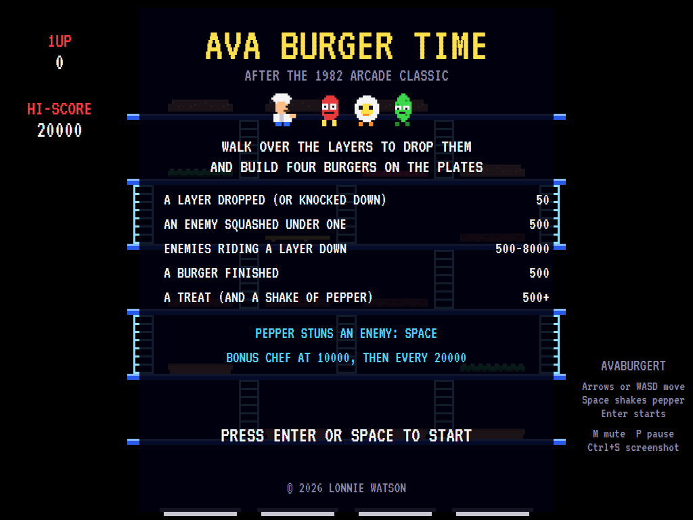
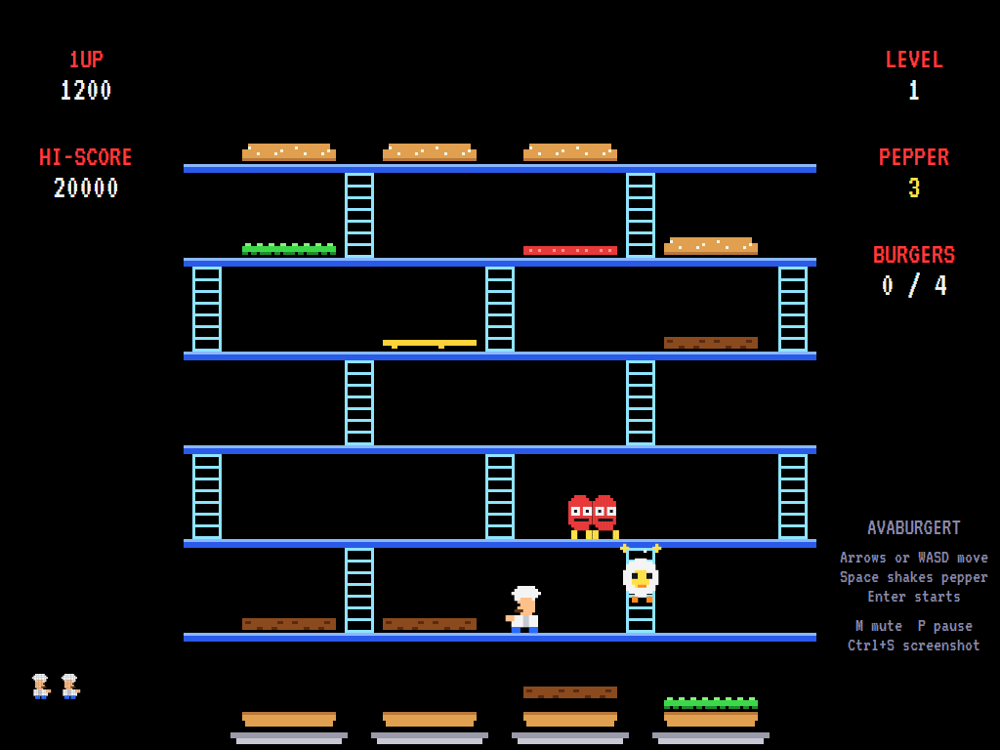
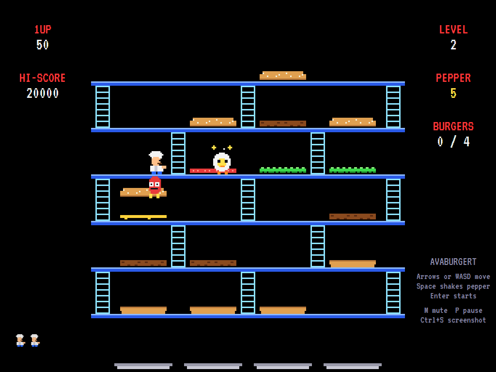
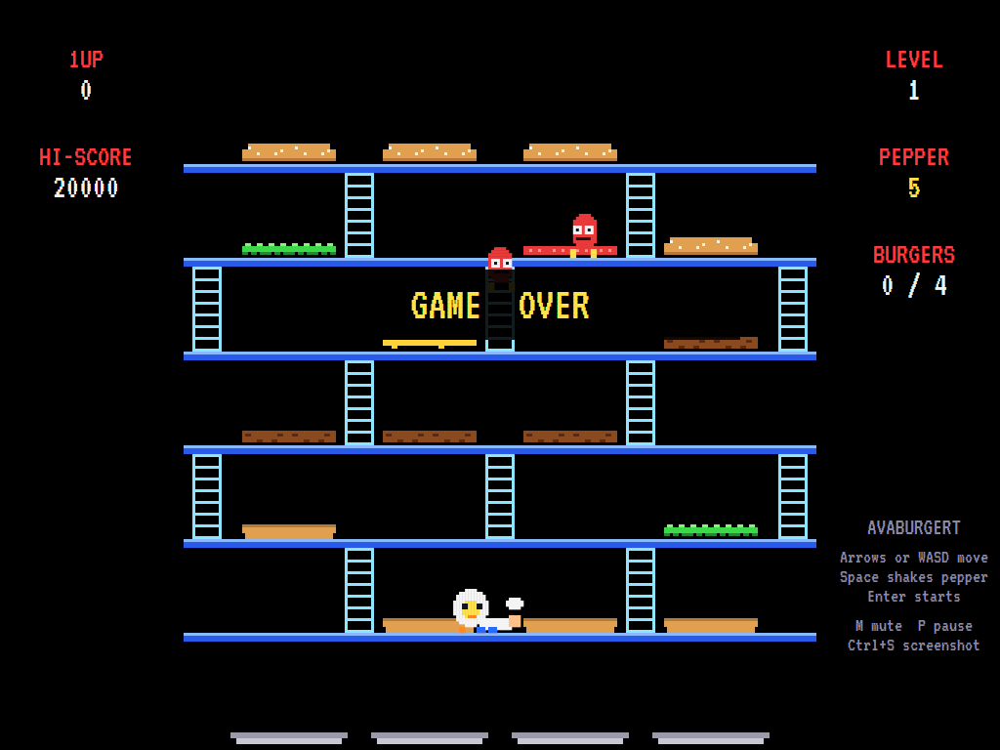
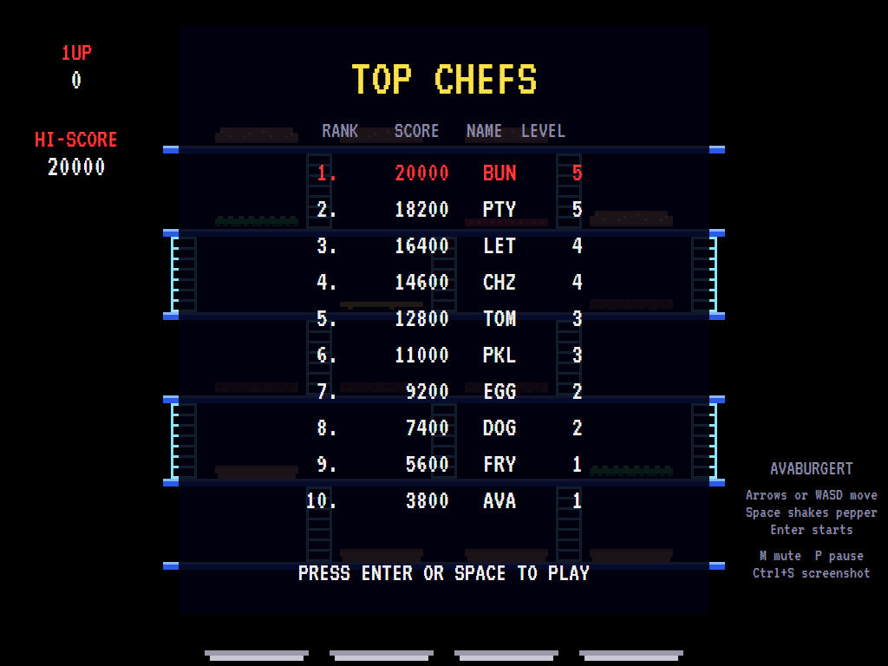

# AVABurgerT

[](https://github.com/Harlock123/AVABurgerT/actions/workflows/build.yml)

A burger-building platform game in the style of Data East's 1982 arcade game **BurgerTime**, built
with .NET 10 and Avalonia UI. Walk across the burger layers lying on the floors to drop them, a floor
at a time, down onto the plates, while a sausage, an egg and a pickle chase you up and down the
ladders. The chef and the enemies are this game's own characters.

## Features

- **Burgers**: four of them, each a top bun, a filling or two (lettuce, cheese, a patty, tomato) and a
  bottom bun, lying on different floors. Walk over all four quarters of a layer (each sags as you go)
  and it drops to the floor below. If there's a layer there, that one gets knocked down in turn. Layers
  that drop off the bottom floor stack up on the plates. Finish all four burgers to clear the level.
- **Enemies** chase you along the floors and up and down the ladders (a little slower on the ladders).
  Drop a layer on one below to **squash** it for 500. Drop a layer with enemies **standing on it** and
  they ride it down an extra floor each, worth 500, 1000, 2000 and up. Squashed enemies come back on
  from the doors at the ends of the top and bottom floors.
- **Pepper**: five shakes to start with. A shake stuns an enemy in front of you (up, down, left or
  right) for a couple of seconds, and you can walk right through a stunned one. Pepper one standing on
  a layer, then drop the layer under it.
- **Treats**: an ice cream, a coffee or fries appear in the middle after every six drops, worth points
  and another shake of pepper.
- **Levels**: each has its own arrangement of layers and ladders, with more enemies (three on level 1,
  up to six) and quicker ones as you go.
- **Music**: an original, bustling kitchen tune loops while you work, plus a title tune and fanfares,
  all mixed by OpenAL.
- **Attract mode**: leave the title alone for 15 seconds and a computer player plays a demonstration,
  with all its sounds. It looks a moment ahead before every move to keep clear of the enemies, and it
  regularly clears whole levels.
- **Three chefs**, a bonus chef at 10,000 and every 20,000 after, and a **top-ten high-score table**
  with arcade-style initials entry.
- **Any window size**: the screen scales to fit, letterboxed. **Ctrl+S** saves a screenshot.
- **One self-contained executable** per platform: Windows, macOS and Linux on Intel/AMD and ARM.

The layouts, sprites, sounds and tunes are all this game's own.

## Screenshots

| Title screen | In the kitchen | Pepper and a ride down |
|:------------:|:--------------:|:----------------------:|
|  |  |  |
| The chef, the enemies and the scoring. | Burgers taking shape on the plates. | A dizzy egg, and a sausage riding a dropped bun down. |

| Game over | The high-score table |
|:---------:|:--------------------:|
|  |  |
| Out of chefs. | The best chefs. |

The screenshots are made by the tests, which play the game in a real (headless) window; see
[Tests](#tests).

## Download and run

Ready-to-run builds for Windows, macOS and Linux, on both Intel/AMD and ARM, are on the
[Releases page](https://github.com/Harlock123/AVABurgerT/releases/tag/latest). **Latest build** is
rebuilt on every push to `main`. Each download is one self-contained executable: no .NET install is
needed.

| Platform | Archive |
|---|---|
| Windows | `AVABurgerT-win-x64.zip`, `AVABurgerT-win-x86.zip`, `AVABurgerT-win-arm64.zip` |
| macOS | `AVABurgerT-osx-arm64.tar.gz` (Apple silicon), `AVABurgerT-osx-x64.tar.gz` (Intel) |
| Linux | `AVABurgerT-linux-x64.tar.gz`, `AVABurgerT-linux-arm64.tar.gz`, `AVABurgerT-linux-arm.tar.gz` |

```bash
tar -xzf AVABurgerT-linux-x64.tar.gz     # or linux-arm64, linux-arm, osx-arm64, osx-x64
./AVABurgerT
```

On Windows, unzip and run `AVABurgerT.exe`. On macOS, if Gatekeeper refuses to open it, run
`xattr -d com.apple.quarantine AVABurgerT` once. Run with `--no-audio` for silence.

**Sound** comes through OpenAL Soft, built in for every platform. In a virtual machine the game
detects it and uses a larger audio buffer, so the sound doesn't break up.

**Gamepads** use SDL2, which is bundled for Windows, macOS and Intel/AMD Linux. ARM Linux builds need it
installed; without it the keyboard still works:

```bash
sudo apt install libsdl2-dev            # Debian / Ubuntu / Raspberry Pi OS
sudo pacman -S --needed sdl2-compat     # Arch / Omarchy
```

## Controls

| Input | Action |
|-------|--------|
| **Arrow keys** / **WASD** | Walk, and climb the ladders (press up or down near one and the chef steps over to it) |
| **Space**, **Ctrl**, **Z** or **X** | Shake pepper the way the chef is facing |
| **Enter** / **Space** | Start a game |
| **P** / **Esc** | Pause (Esc again to quit) |
| **M** | Mute |
| **Ctrl+S** / **Cmd+S** | Save a screenshot to the Pictures folder |

**Gamepad**: the left stick or D-pad moves, **A**, **B** or **X** shakes pepper, **Start** starts and
pauses, **Back** (while paused) quits.

**Entering initials**: type letters, or dial with **Up**/**Down** and accept with **Space**; **Left** /
**Backspace** go back; **Enter** finishes.

## Scoring

| What | Points |
|---|---:|
| A layer dropped, or knocked down by one above | 50 |
| An enemy squashed under a falling layer | 500 |
| Enemies riding a layer down: one, two, three, four | 500, 1000, 2000, 4000 |
| A burger finished | 500 |
| A treat (plus a shake of pepper) | 500, 1000, then 1500 |

## Tests

```bash
dotnet test AVABurgerT.slnx
```

The engine has no UI and runs in fixed 60 Hz steps, so it plays the same at any frame rate, and a seed
always plays the same game. The tests check:

- every kitchen (burgers in order, every floor joined, no ladder through a burger);
- walking and climbing;
- dropping layers and knocking down the one below;
- stacking burgers on the plates, and finishing a level;
- squashing enemies and taking them for a ride;
- pepper;
- being caught, and enemies climbing after the chef;
- treats and bonus chefs;
- the title tune, the demonstration's sound, pausing the music, and every sound and sprite.

A computer player (the attract-mode one) plays whole games in them and must finish a level.

The screenshot tests draw the real screen in a headless window. To refresh the README's pictures:

```bash
BURGER_SHOTS=$PWD/Images dotnet test tests/AVABurgerT.Tests --filter ScreenshotTests
```

## Building

```bash
dotnet build AVABurgerT.slnx
dotnet run --project src/AVABurgerT
```

Needs the .NET 10 SDK. The sounds are made by `tools/make_sounds.py` (standard-library Python):
`python3 tools/make_sounds.py` rewrites `src/AVABurgerT/Sounds`.

## Project structure

```
AVABurgerT/
├── AVABurgerT.slnx
├── src/AVABurgerT/
│   ├── Engine/
│   │   ├── GameEngine.cs        # States, scoring, bonus chefs and the music
│   │   ├── GameEngine.Play.cs   # Walking and climbing, dropping and knocking layers, plates, squashing
│   │   │                        # and riding, pepper, treats, the enemies and the levels
│   │   ├── Entities.cs          # The chef, the enemies and the pepper
│   │   ├── AttractPilot.cs      # The computer player for the demonstration (and the tests)
│   │   ├── HighScoreTable.cs, InitialsEntry.cs
│   │   ├── InputHandler.cs, ControllerManager.cs  # Keys and an SDL2 gamepad
│   │   └── SoundManager.cs      # Effects, tunes and the kitchen music through OpenAL
│   ├── Audio/                   # The OpenAL engine (from the author's AVABand)
│   ├── Models/                  # The kitchen layouts and burger layers, and the pixel art
│   ├── Views/                   # The screen: floors, ladders, burgers, the chef and enemies, panels
│   └── Sounds/                  # The synthesised effects and tunes
├── tests/AVABurgerT.Tests/      # Gameplay and screenshot tests
├── tools/make_sounds.py
└── Images/                      # Screenshots
```

## About and licence

AVABurgerT © 2026 Lonnie Watson, under the [MIT License](LICENSE).

*BurgerTime* © 1982 Data East; the name belongs to its current owner. AVABurgerT is an independent,
unofficial game in its style. Its characters, layouts, sprites, sounds, tunes and code are its own;
nothing is taken from the arcade machine's program, graphics or sound. It is not affiliated with or
endorsed by any rights holder.

Bundled components keep their own licences: the VT323 font (SIL Open Font License 1.1, by Peter Hull;
`src/AVABurgerT/Assets/Fonts/VT323-OFL.txt`), OpenAL Soft (LGPL-2.0-or-later; loaded as a separate
library; `src/AVABurgerT/Audio/native/COPYING-openal-soft.txt`), and the MIT-licensed Avalonia,
Silk.NET, NVorbis, NLayer and SDL2-CS (with SDL2 under the zlib licence).
